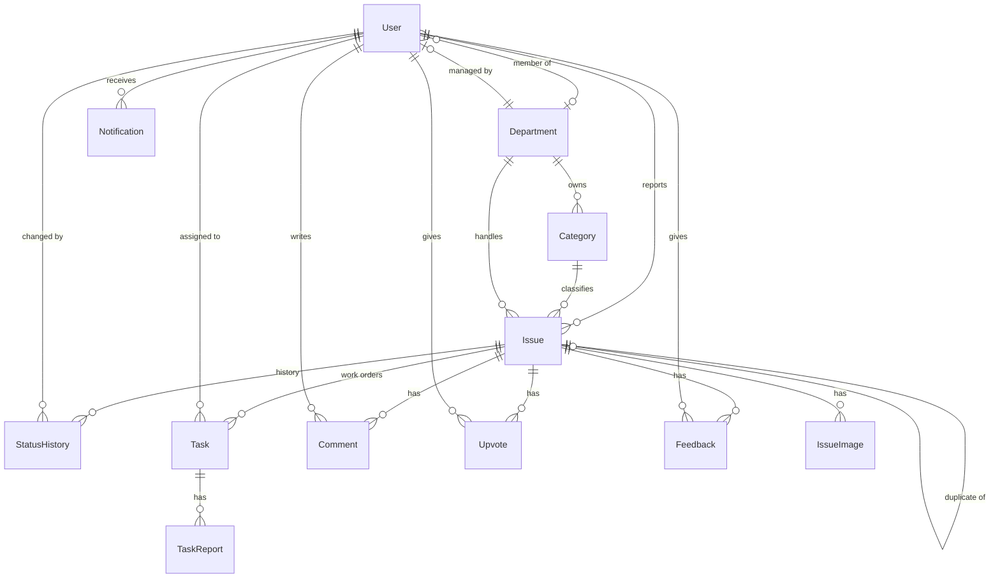

# CivicPulse

**Smart City Infrastructure Management Platform.** Citizens report public infrastructure problems (broken roads, dead streetlights, blocked drains, damaged footpaths, waste); government departments verify, assign, track and resolve them through one transparent workflow.

- **Live demo:** https://civicpulse-nu-ten.vercel.app/

- **Source code:** https://github.com/mndbobby61-blip/civicpulse

## Demo credentials

Password for **every** account: `Demo@1234`

| Role | Email | Notes |
|---|---|---|
| Admin | `admin@civicpulse.test` | Sees everything, manages users and departments |
| Department Manager | `manager@civicpulse.test` | Roads & Highways. `manager2` to `manager5@civicpulse.test` run the other four departments |
| Maintenance Staff | `staff@civicpulse.test` | Roads & Highways crew. `staff2` to `staff24@civicpulse.test` for others |
| Citizen | `citizen@civicpulse.test` | `citizen2` to `citizen40@civicpulse.test` also exist |

New citizens can also sign up at `/register`. Registration always creates a Citizen; the role is never read from the form.

## Tech stack

| Area | Technology |
|---|---|
| Framework | Next.js 16 (App Router, Cache Components / Partial Prerendering), React 19, TypeScript |
| Styling | Tailwind CSS 4 base + custom CSS design system (gradients, 3D map, glass UI), light and dark mode |
| Database | PostgreSQL on Neon, Prisma 7 ORM (`prisma-client` generator, Neon adapter) |
| Auth | Own implementation: bcryptjs password hashing, signed JWT (`jose`) in an httpOnly cookie |
| Validation | Zod |
| Maps | Leaflet + OpenStreetMap tiles |
| Charts | Recharts |
| Images | Cloudinary (unsigned client upload, optional) |
| Hosting | Vercel (with a daily Vercel Cron job) |

## Features

### Public (no login)
- 18-section landing page: animated 3D hero, live statistics read from the database, how it works, comparison, features, live issue map preview, before/after slider, area report cards (from real data), SLA promises, department leaderboard, security, roadmap, FAQ
- **Track a report** by its number, without logging in (returns only title, status, category, area and timeline; no personal data)
- Public **issue map** with status filter, heatmap mode and a "last N days" time slider
- Bangla / English switch and light / dark toggle; both preferences are remembered
- Responsive layout with a mobile menu

### Citizen
- Report an issue: title, category, description, address, **pin on the map** or GPS "use my location", up to 3 photos (Cloudinary), optional anonymous mode
- **Automatic duplicate detection**: an open issue of the same category within about 50 m is linked as a duplicate and receives an upvote instead of a second ticket
- My reports and a read-only **community view** of all issues
- **"Me too" upvotes** (not on own issue, toggle on/off) and **comments**
- Rate a fix after it is resolved
- **Civic points, levels (Bronze, Silver, Gold, Platinum), 6 badges** and a leaderboard
- Notification bell, plus a toast that drops from the top when something new arrives

### Department Manager
- Sees only their own department's issues
- Verify an issue, assign a staff member (workload per person is shown and the least busy one is marked with a star), close or reopen a resolved issue
- Department analytics charts
- Gets a notification when a new issue arrives or when an SLA deadline is missed

### Maintenance Staff
- Sees only issues assigned to them
- Start work and mark as resolved (task status follows automatically)

### Admin
- Dashboard: **City Health Score**, monthly trend, category and status distribution, resolution time per department
- **User management**: search, role filter, change role and department, activate or deactivate (a deactivated user can no longer log in)
- **Department management**: create, enable or disable
- **Audit log** page: permanent record of who changed what

### System
- **Priority score (0 to 100)** with sorting by priority and an "SLA overdue" badge
- **Notifications**: bell dropdown, toast, full page, mark as read (polled every 30 s)
- Server-side search (debounced), status filter and pagination on issue and user lists
- Daily **SLA overdue alert** job for managers
- Immutable status history and audit logging

## Issue workflow

```
Submitted -> Under Review -> Assigned -> In Progress -> Resolved -> Closed
```

Every transition stores the previous status, the new status, the user and the timestamp (`StatusHistory`). All rules below are enforced **on the server**.

| Action | Who | From -> To |
|---|---|---|
| Start review | Manager (own department) or Admin | Submitted -> Under Review |
| Assign staff | Manager (own department) or Admin; staff must belong to the same department | Under Review -> Assigned |
| Start work | The assigned staff member only | Assigned -> In Progress |
| Mark resolved | The assigned staff member only | In Progress -> Resolved |
| Close | Manager (own department) or Admin | Resolved -> Closed |
| Reopen | Manager (own department) or Admin | Resolved -> In Progress |
| Rate | The reporting citizen only | Resolved or Closed |
| Upvote | Any citizen except the reporter, not on Closed issues | any open status |

## How the scores work

**Priority score** (0 to 100, only for open issues): severity (Low 10, Medium 20, High 30, Critical 40) + votes (1 point each, max 20) + age (2 points per day open, max 20) + SLA overdue (20).

**Civic points:** report +10, own report resolved +20, rating given +5, each upvote received +1. Levels start at 0, 60, 150 and 300 points. Points are computed from real records every time; they are not stored, so they can never drift out of sync.

**City Health Score** (admin, 0 to 100): 35% resolution rate + 25% fixes completed within SLA + 20% citizen satisfaction (average rating / 5) + 20% overdue-free backlog. This formula is our own design, not an official standard.

**Duplicate detection:** same category, still open, inside a +/-0.00045 degree bounding box (about 50 m) around the new pin.

## Database design



| Table | Purpose |
|---|---|
| `User` | Account, role (`ADMIN`, `MANAGER`, `STAFF`, `CITIZEN`), department, active flag |
| `Department`, `Category` | Departments and issue categories (each category has an SLA in hours and an owning department) |
| `Issue` | The report: status, priority, address, latitude and longitude, anonymous flag, upvote count, SLA due date, duplicate link |
| `IssueImage` | Photo URLs of an issue |
| `StatusHistory` | Immutable log of every status change |
| `Task` | Assignment of an issue to a staff member |
| `Comment`, `Upvote`, `Feedback` | Community engagement and ratings (one upvote and one rating per user per issue) |
| `Notification` | In-app notifications |
| `AuditLog` | Who did what to which record |
| `TaskReport`, `Setting` | Defined in the schema, user interface not built yet |

Indexes exist on issue status, department and status, category, latitude and longitude, creation date, task assignee, and notification recipient. The full schema is in `prisma/schema.prisma`.

## API documentation

The application mainly uses **Next.js Server Actions** (server-only functions that re-check the session on every call), plus a few JSON route handlers.

### Server actions

| Action | File | Allowed roles | What it does |
|---|---|---|---|
| `registerAction` | `lib/auth-actions.ts` | Public | Creates a Citizen account and a session |
| `loginAction` | `lib/auth-actions.ts` | Public | Verifies credentials, sets the session cookie; only same-site `next` redirects are accepted |
| `logoutAction` | `lib/auth-actions.ts` | Any | Clears the session |
| `createIssueAction` | `lib/issue-actions.ts` | Citizen | Validates input (including a GPS range), detects duplicates, writes issue, history, notification and audit log in one transaction |
| `updateStatusAction` | `lib/issue-actions.ts` | Admin, Manager, Staff | Moves an issue to the next allowed status (role, ownership and transition are checked) |
| `assignAction` | `lib/issue-actions.ts` | Admin, Manager | Assigns a staff member of the same department |
| `feedbackAction` | `lib/issue-actions.ts` | Citizen (reporter) | Saves a 1 to 5 rating on a resolved issue |
| `toggleUpvoteAction` | `lib/engage-actions.ts` | Citizen | Adds or removes an upvote (not on own issue) |
| `addCommentAction` | `lib/engage-actions.ts` | Any role that can see the issue | Adds a comment and notifies the reporter |
| `deleteCommentAction` | `lib/engage-actions.ts` | Author, department manager, admin | Deletes a comment and writes an audit log |
| `updateUserAction` | `lib/admin-actions.ts` | Admin | Changes role, department and active flag (an admin cannot demote or deactivate themselves) |
| `createDeptAction`, `toggleDeptAction` | `lib/admin-actions.ts` | Admin | Creates or enables / disables a department |
| `markAllReadAction`, `updateProfileAction` | `lib/account-actions.ts` | Logged-in user | Marks notifications read; updates name, phone, password |

### JSON route handlers

| Endpoint | Access | Response |
|---|---|---|
| `GET /api/me` | Public | `{ user: { name, role } }` or `{ user: null }` |
| `GET /api/notifications` | Logged in (401 otherwise) | `{ items: [...] }`, the latest 20 of the current user |
| `POST /api/notifications` | Logged in | Body `{ ids?: string[] }` marks the user's own notifications as read (all if `ids` is omitted) |
| `GET /api/stats` | Public, cached 60 s | `{ total, resolved, hours, satisfied }` aggregate figures |
| `GET /api/areas` | Public, cached 60 s | Top areas: `[{ name, total, solved }]` |
| `GET /api/track?code=N` | Public | `{ found, title, status, cat, area, history[] }`. 400 for an invalid number. Contains no personal data |
| `GET /api/cron/sla` | `Authorization: Bearer <CRON_SECRET>` (401 otherwise) | Creates one SLA-overdue notification per late issue for its department manager; `{ checked, notified }` |

## Security and data integrity

- Passwords are hashed with bcrypt; sessions are signed JWTs in `httpOnly`, `sameSite=lax` cookies (`secure` in production)
- The role is never taken from client input; registration always creates a Citizen
- Every protected page and every server action calls `requireRole()`, which loads the user from the database, rejects inactive accounts and wrong roles
- **Row-level rules in code:** managers only touch their department; staff only touch issues assigned to them; citizens can only change their own issues; citizens can view all issues read-only (for voting and discussion)
- Anonymous reports hide the reporter's name from everyone except managers, admins and the reporter
- Status changes follow a fixed transition table, so a tampered form cannot skip steps
- All input is validated with Zod; latitude and longitude must be inside the Bangladesh range; image URLs must come from our own Cloudinary account; free text is rendered as text, never as HTML (map popups are built with `textContent`)
- Multi-table writes run inside database transactions
- The public track endpoint exposes no names, emails or staff details
- The cron endpoint refuses requests without the secret

## Seed data

`npx prisma db seed` creates 5 departments, 6 categories, 70 users (1 admin, 5 managers, 24 staff, 40 citizens), 150 issues spread over 10 Dhaka areas with distinct GPS points, status history for every issue, tasks and ratings. Running it again resets the data.

## Getting started

```bash
git clone https://github.com/mndbobby61-blip/civicpulse.git
cd civicpulse
npm install
cp .env.example .env        # then fill in the values below
npx prisma migrate dev
npx prisma db seed
npm run dev                 # http://localhost:3000
```

### Environment variables

| Variable | Required | Description |
|---|---|---|
| `DATABASE_URL` | Yes | Neon **pooled** connection string (host contains `-pooler`) |
| `DATABASE_URL_UNPOOLED` | Yes | Neon **direct** connection string, used by Prisma CLI |
| `AUTH_SECRET` | Yes | Random 32+ byte secret for signing sessions |
| `CRON_SECRET` | For the SLA job | Secret the cron endpoint expects |
| `NEXT_PUBLIC_CLOUDINARY_CLOUD` | Optional | Cloudinary cloud name (photo upload is hidden if missing) |
| `NEXT_PUBLIC_CLOUDINARY_PRESET` | Optional | Cloudinary **unsigned** upload preset name |

## Deployment

1. Push to GitHub and import the repository in Vercel
2. Add the environment variables above (without quotes)
3. Deploy. `postinstall` runs `prisma generate`, and `vercel.json` registers the daily SLA cron job (03:00 UTC)

## Project structure

```
prisma/            schema.prisma, seed.ts
src/app/           pages (App Router), api/ route handlers, civicpulse.css
src/components/    UI: landing sections, dashboards, forms, map, charts
src/lib/           db, session, permissions, server actions, scoring (priority, gamify, health)
src/generated/     Prisma client (generated, git-ignored)
```

## Testing

There are no automated tests yet. The application was verified with a manual role-by-role test plan covering the full issue lifecycle, permission denials, duplicate detection, notifications, language and theme switching, and responsive layouts.

## Known limitations and roadmap

Honest list of what is **not** built:

- Notifications are **polled every 30 seconds**, not pushed in real time
- Staff cannot yet upload completion photos or progress reports (the `TaskReport` table is ready)
- No email or SMS notifications, no PDF or CSV export, no marker clustering
- No automated test suite
- The landing page's before/after picture, ticker items and testimonials are illustrative samples, not live data
- Planned: AI photo classification, voice reporting in Bangla, offline reports (PWA)