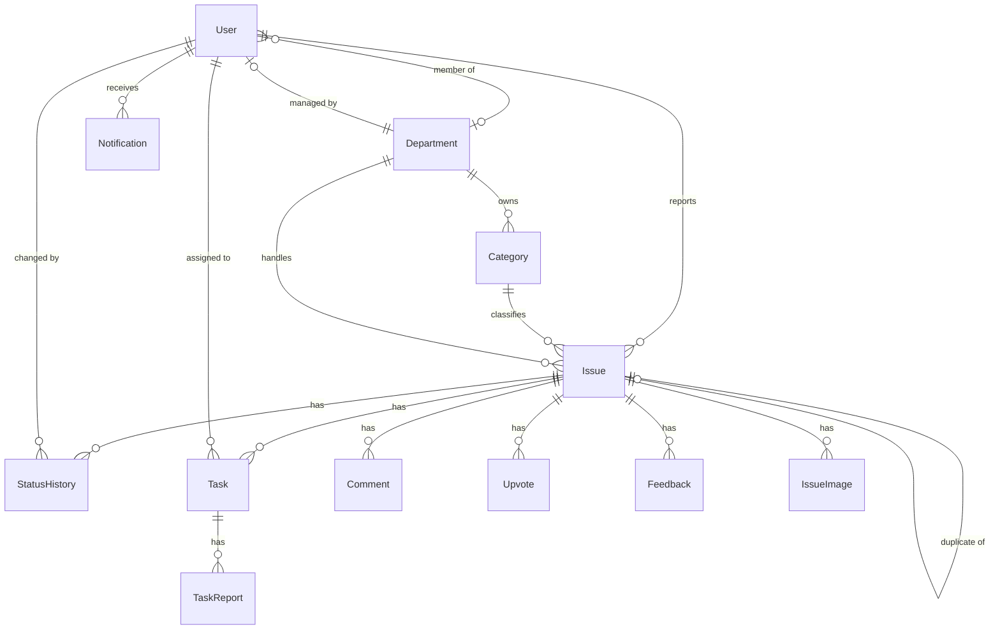

# CivicPulse

Smart City Infrastructure Management Platform. Citizens report public infrastructure problems; departments verify, assign and resolve them.

**Live:** <আপনার-vercel-লিংক>
**Repo:** <আপনার-github-লিংক>

## Demo credentials (password for all: `Demo@1234`)

| Role | Email |
|---|---|
| Admin | admin@civicpulse.test |
| Department Manager | manager@civicpulse.test |
| Maintenance Staff | staff@civicpulse.test |
| Citizen | citizen@civicpulse.test |

## Tech stack
Next.js 16 (App Router) · React 19 · TypeScript · Tailwind CSS · PostgreSQL (Neon) · Prisma 7 · Recharts · Leaflet + OpenStreetMap · jose (JWT sessions) · bcryptjs · Zod

## Features
- Role-based access (Admin, Manager, Staff, Citizen), enforced on the server
- Issue reporting with map pin, GPS, anonymous option and automatic duplicate detection (same category within 50 m)
- Issue workflow: Submitted → Under Review → Assigned → In Progress → Resolved → Closed
- Every status change is stored with the user and timestamp (immutable history)
- Task assignment by department managers, workload shown per staff member
- Citizen rating after resolution
- Server-side search, status filter and pagination
- Analytics dashboard (monthly trend, category and status distribution, department resolution time)
- Bangla / English language switch, responsive UI, dark mode

## Workflow rules (server-enforced)
| Action | Allowed role | From → To |
|---|---|---|
| Start review | Manager (own dept) / Admin | Submitted → Under Review |
| Assign staff | Manager (own dept) / Admin | Under Review → Assigned |
| Start work | Assigned staff only | Assigned → In Progress |
| Mark resolved | Assigned staff only | In Progress → Resolved |
| Close / Reopen | Manager (own dept) / Admin | Resolved → Closed / In Progress |
| Rate | Reporting citizen only | Resolved or Closed |

## Security
- Passwords hashed with bcrypt; sessions are signed, httpOnly JWT cookies
- Role is never taken from client input; registration always creates a Citizen
- Every page and server action calls `requireRole()`; managers are limited to their own department; citizens to their own reports
- GPS range and all form fields validated with Zod
- Multi-table writes run inside database transactions

## Setup
```bash
npm install
cp .env.example .env     # fill DATABASE_URL, DATABASE_URL_UNPOOLED, AUTH_SECRET
npx prisma migrate dev
npx prisma db seed       # 5 departments, 70 users, 150 issues
npm run dev
```

## Database design

Full schema: `prisma/schema.prisma`.

## API / server actions
The app uses Next.js Server Actions (server-only, session-checked) instead of REST routes.

| Action | File | Who | Purpose |
|---|---|---|---|
| `registerAction` | lib/auth-actions.ts | Public | Create citizen account |
| `loginAction` | lib/auth-actions.ts | Public | Sign in, set session cookie |
| `logoutAction` | lib/auth-actions.ts | Any | Clear session |
| `createIssueAction` | lib/issue-actions.ts | Citizen | Submit issue, detect duplicates |
| `updateStatusAction` | lib/issue-actions.ts | Admin, Manager, Staff | Move issue to next status (role and ownership checked) |
| `assignAction` | lib/issue-actions.ts | Admin, Manager | Assign staff to a task |
| `feedbackAction` | lib/issue-actions.ts | Citizen (reporter) | Rate a resolved issue |

## Not yet implemented
Image upload, full map view page, user and department management screens, notifications UI, profile settings.